# ShopBondhu: Custom AWS VPC with Public and Private Subnets, NAT Gateway, and Nginx

## Project Description

This project builds a custom AWS network for ShopBondhu, a small e-commerce startup in Dhaka. Instead of the default VPC, I created a dedicated VPC with a public subnet and a private subnet. An Ubuntu web server in the public subnet runs Nginx and serves the static landing page to the internet. An Ubuntu backend server in the private subnet has no public IP, so it cannot be reached from the internet, but it can still download updates through a NAT Gateway.

- **Region:** `ap-southeast-2` (Sydney)
- **AWS account:** `687008038217`

---

## Architecture Diagram


- **VPC `shopbondhu-vpc`** (10.0.0.0/16)
- **Public subnet `shopbondhu-public-subnet`** (10.0.1.0/24): contains the web server and the NAT Gateway. Its route table sends `0.0.0.0/0` to the Internet Gateway.
- **Private subnet `shopbondhu-private-subnet`** (10.0.2.0/24): contains the backend server. Its route table sends `0.0.0.0/0` to the NAT Gateway.
- **Internet Gateway `shopbondhu-igw`**: attached to the VPC.
- **NAT Gateway `shopbondhu-nat`**: placed in the public subnet, with an Elastic IP.

---

## Resources Created

| Resource | Name | CIDR / ID | Notes |
|---|---|---|---|
| VPC | shopbondhu-vpc | 10.0.0.0/16 (vpc-01ebedcf8d5e12995) | Custom VPC, not the default VPC |
| Public subnet | shopbondhu-public-subnet | 10.0.1.0/24 (subnet-0ee6ad5fd1dcb2a8e) | Auto-assign public IPv4 enabled |
| Private subnet | shopbondhu-private-subnet | 10.0.2.0/24 (subnet-07014946040b9c77b) | Auto-assign public IPv4 disabled |
| Internet Gateway | shopbondhu-igw | igw-066374609bda312b1 | Attached to shopbondhu-vpc |
| NAT Gateway | shopbondhu-nat | nat-0f54da0a183357f9a | In the public subnet, with an Elastic IP. Deleted after the assignment |
| Elastic IP | (NAT Gateway EIP) | Released after cleanup | Attached to shopbondhu-nat |
| Public route table | shopbondhu-public-rt | rtb-0fb1e07b81cd08568 | 0.0.0.0/0 → shopbondhu-igw |
| Private route table | shopbondhu-private-rt | rtb-0af88dc28c91a621a | 0.0.0.0/0 → shopbondhu-nat |
| Web security group | shopbondhu-web-sg | sg-0eb5660d5115b3bea | SSH (22) from my IP; HTTP (80) from 0.0.0.0/0 |
| Backend security group | shopbondhu-backend-sg | sg-09599df58b7bcf19d | SSH (22) from shopbondhu-web-sg only |
| Web server | shopbondhu-web | i-031159d96796be947 | Ubuntu 26.04 LTS, t3.micro, public subnet. Terminated after cleanup |
| Backend server | shopbondhu-backend | i-06244e6cfbdf38090 | Ubuntu 26.04 LTS, t3.micro, private subnet, private IP 10.0.2.35. Terminated after cleanup |

---

## Step-by-Step Setup

### Task 1: Create the VPC

I created a VPC named `shopbondhu-vpc` with the IPv4 CIDR block `10.0.0.0/16`. I did not use the default VPC, as the CTO instructed.

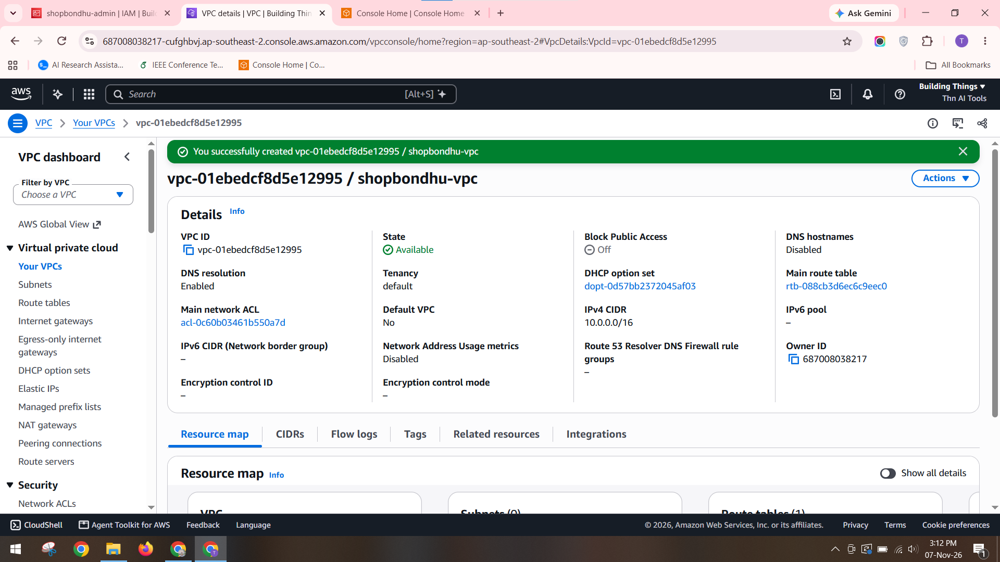

### Task 2: Create the subnets

I created the public subnet `shopbondhu-public-subnet` with CIDR `10.0.1.0/24` and turned on **Auto-assign public IPv4 address**. I created the private subnet `shopbondhu-private-subnet` with CIDR `10.0.2.0/24` and left auto-assign public IP off, so the backend has no public address.

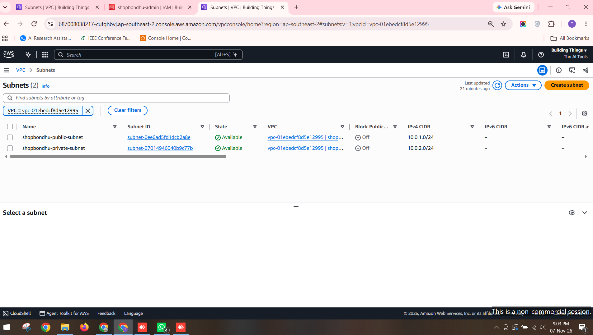

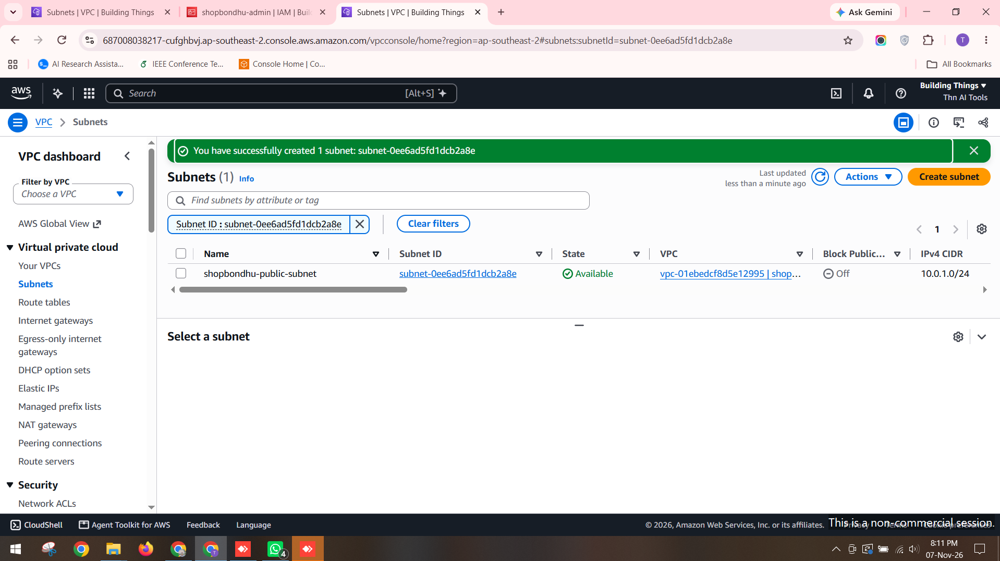

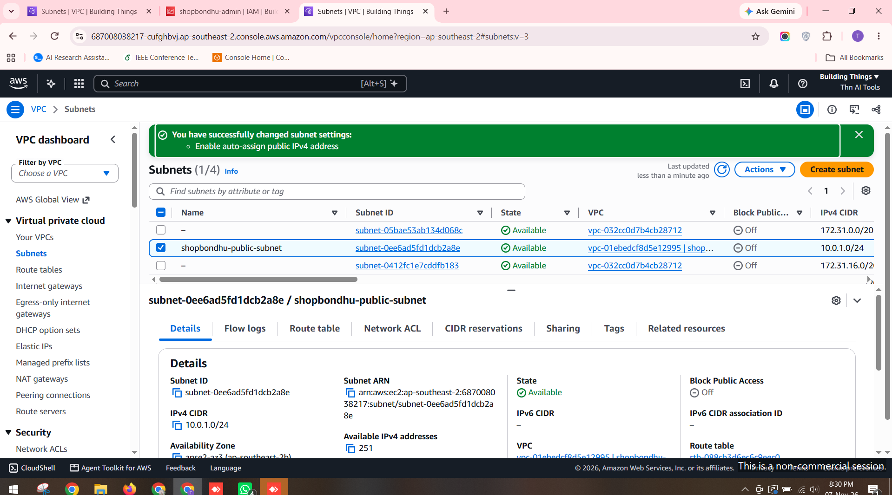

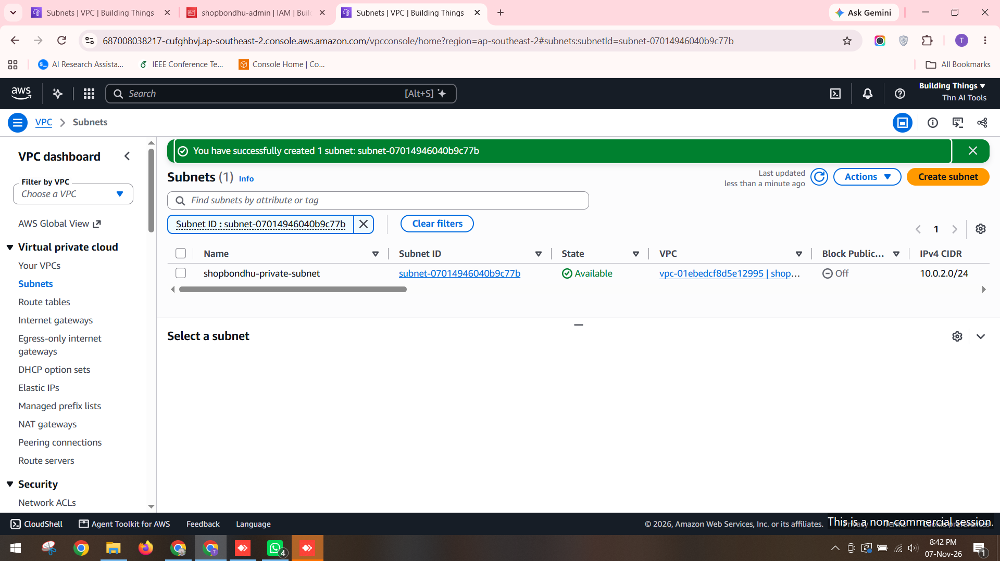

### Task 3: Internet Gateway

I created the Internet Gateway `shopbondhu-igw` and attached it to `shopbondhu-vpc`. The Internet Gateway allows resources in the public subnet to communicate with the internet.

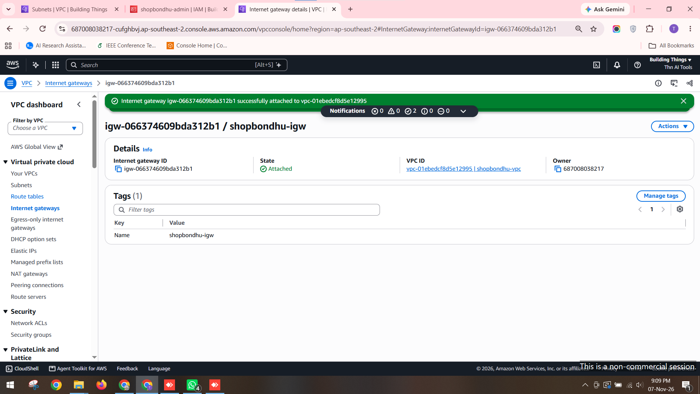

### Task 4: NAT Gateway

I allocated an Elastic IP and created the NAT Gateway `shopbondhu-nat` in the **public** subnet, with the Elastic IP attached. It must be in the public subnet because it needs a route to the Internet Gateway to forward traffic from the private subnet.

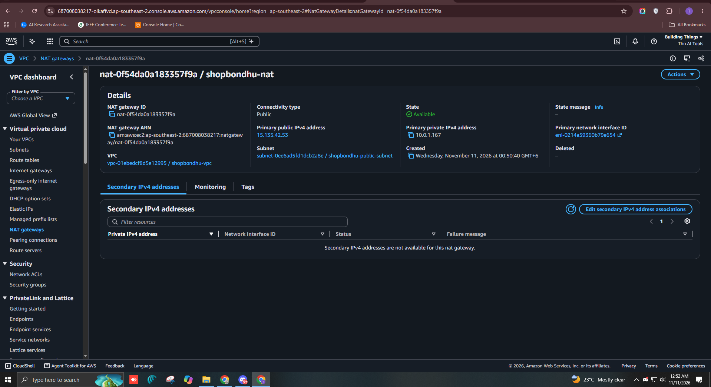

### Task 5: Route tables

**Public route table (`shopbondhu-public-rt`)**
- Route: `0.0.0.0/0` → `shopbondhu-igw`
- Associated with `shopbondhu-public-subnet`

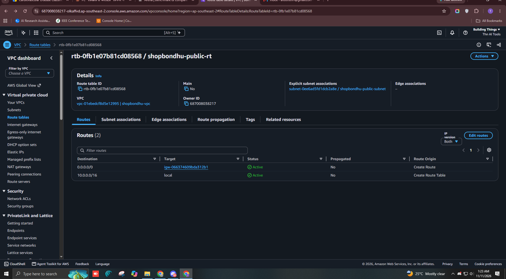


**Private route table (`shopbondhu-private-rt`)**
- Route: `0.0.0.0/0` → `shopbondhu-nat`
- Associated with `shopbondhu-private-subnet`

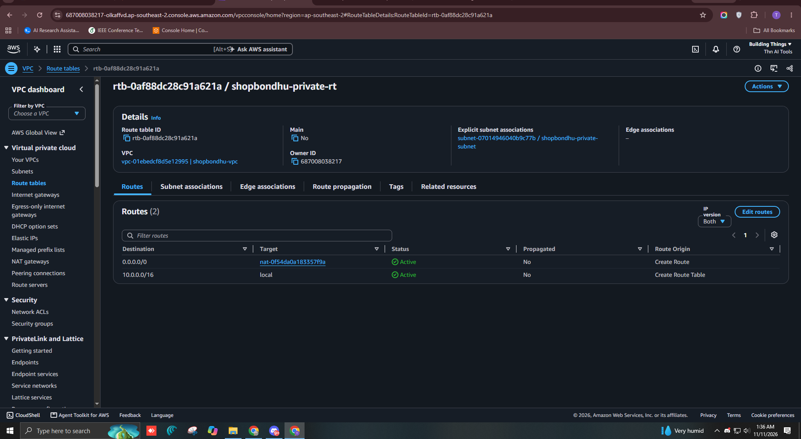

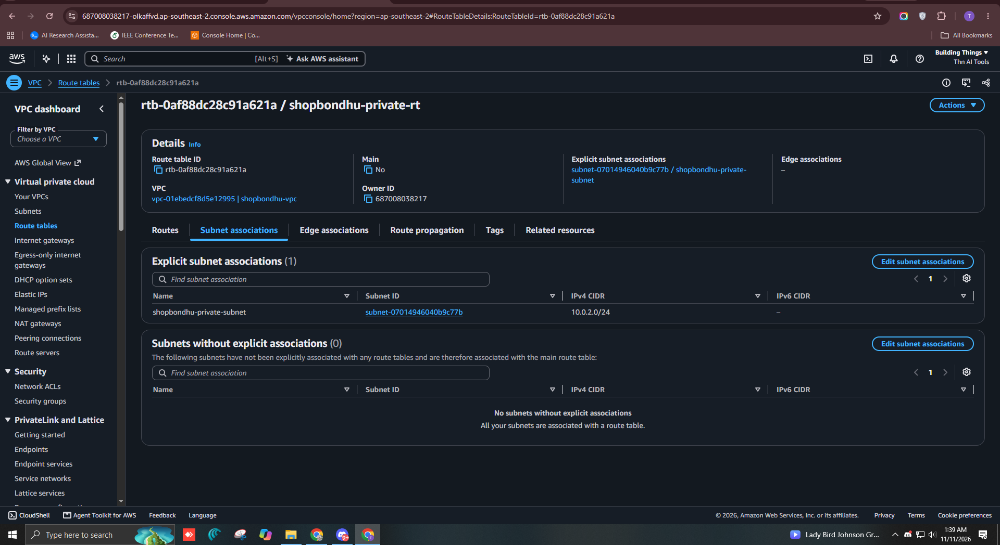

### Task 6: Security groups and EC2 instances

**Web security group (`shopbondhu-web-sg`)**
- Inbound: SSH (22) from my public IP only, HTTP (80) from `0.0.0.0/0`

**Backend security group (`shopbondhu-backend-sg`)**
- Inbound: SSH (22) with the source set to `shopbondhu-web-sg`. The source is a security group, not an IP address, so only instances in the web security group can SSH into the backend.

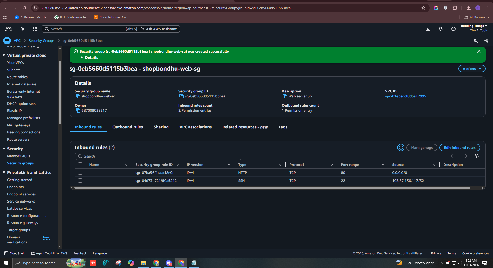

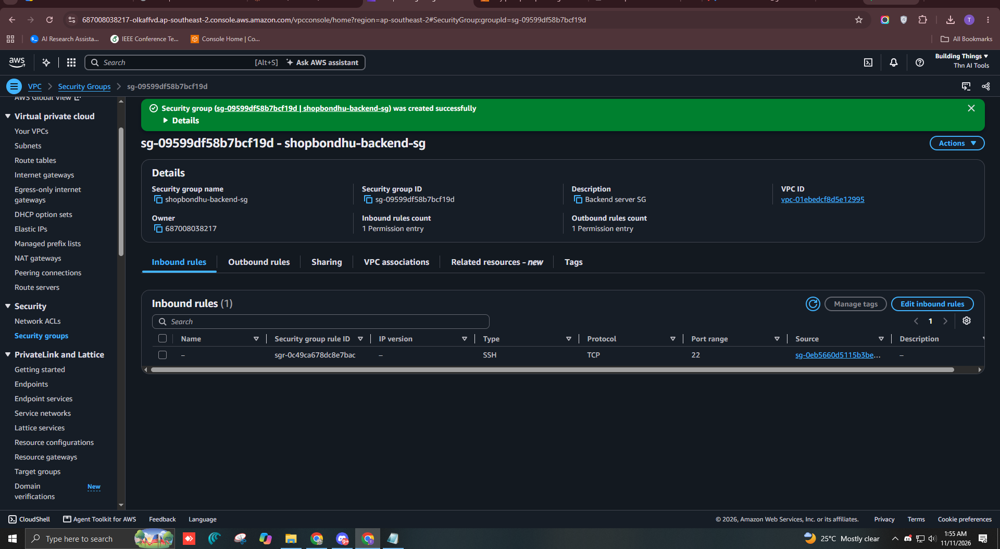

**Web server (`shopbondhu-web`):** Ubuntu 26.04 LTS, t3.micro, in the public subnet with auto-assigned public IP enabled, using `shopbondhu-web-sg`.

**Backend server (`shopbondhu-backend`):** Ubuntu 26.04 LTS, t3.micro, in the private subnet with auto-assign public IP disabled, using `shopbondhu-backend-sg`.

Both instances use the key pair `shopbondhu-key`. The private key file is not included in this repository.


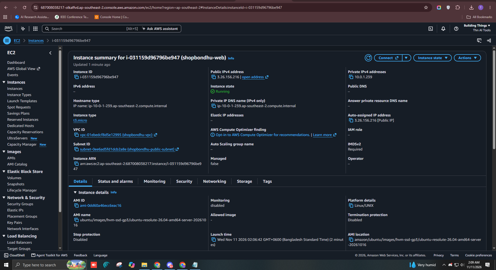

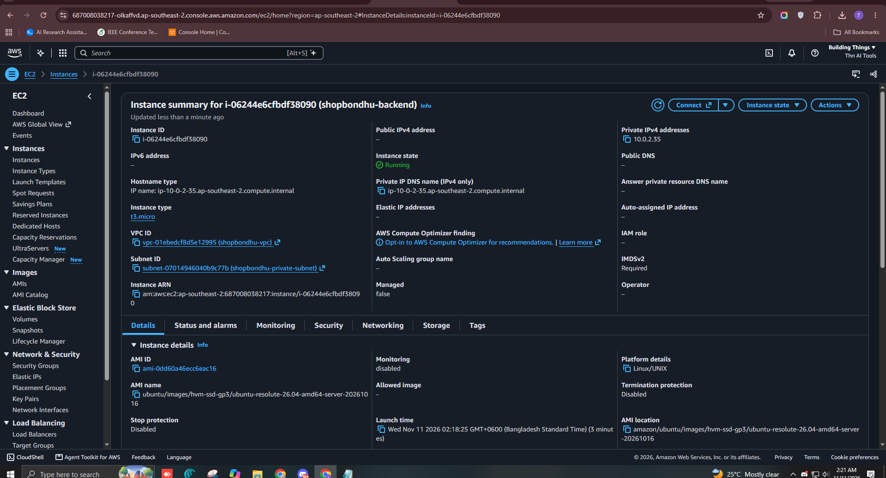

---

## Nginx and Frontend Deployment

### Install and start Nginx

I connected to the web server over SSH, updated the packages, and installed Nginx:

```bash
sudo apt update && sudo apt upgrade -y
sudo apt install nginx -y
sudo systemctl enable --now nginx
sudo systemctl status nginx
```

Nginx shows `active (running)` and is enabled to start on boot.

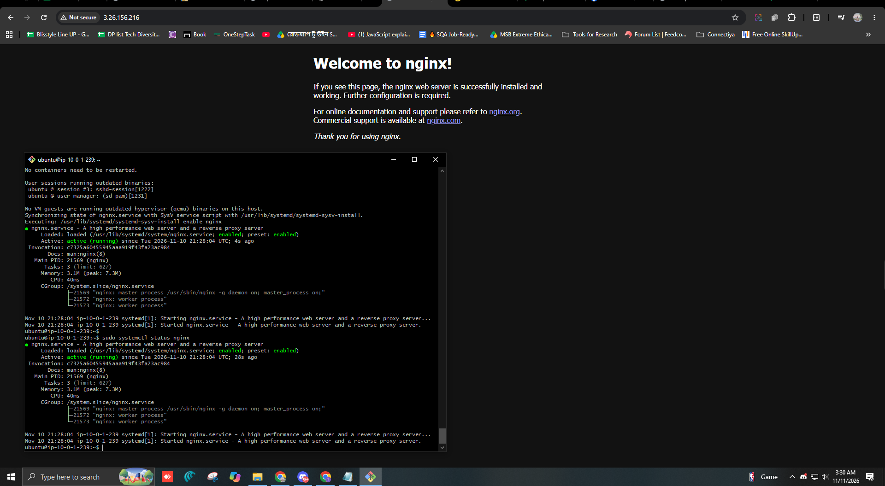

### Deploy the landing page

I copied the frontend files (`index.html`, `style.css`, `script.js`) from my laptop to the web server with `scp`, then moved them into the Nginx web root:

```bash
scp -i shopbondhu-key.pem -r frontend ubuntu@<web-public-ip>:/tmp/
sudo rm -f /var/www/html/index.html
sudo cp -r /tmp/frontend/* /var/www/html/
sudo systemctl reload nginx
```

The landing page loads at `http://<web-public-ip>`. During the assignment, the web server's public IP was `3.26.156.216`. That IP stops working after the instance is terminated.

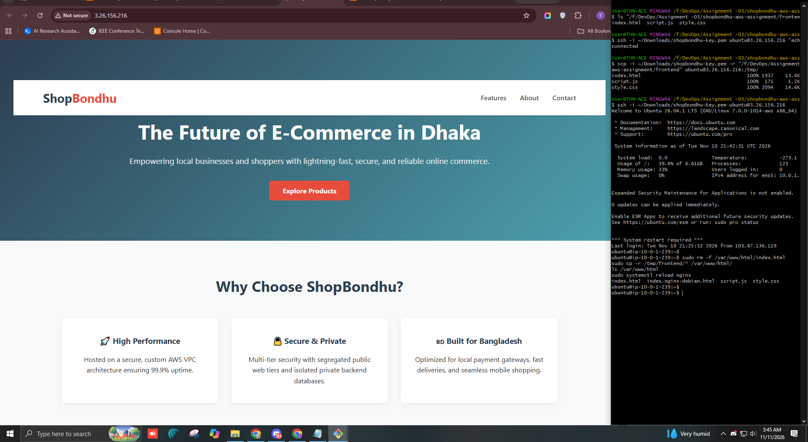

---

## NAT Gateway Test

### Access the backend through the web server

The backend has no public IP, so I reached it through the web server, which acts as a jump host. I did not store the private key on the server. Instead, I used SSH agent forwarding:

```bash
# On the laptop
eval $(ssh-agent -s)
ssh-add shopbondhu-key.pem
ssh -A ubuntu@<web-public-ip>

# On the web server
ssh ubuntu@10.0.2.35
```

### Test outbound internet access from the backend

On the backend, I ran:

```bash
sudo apt update
curl -I https://google.com
```

`apt update` completed successfully, and `curl` returned `HTTP/2 301`, redirecting to `https://www.google.com/`. This shows the backend can reach the internet through the NAT Gateway even though it has no public IP.

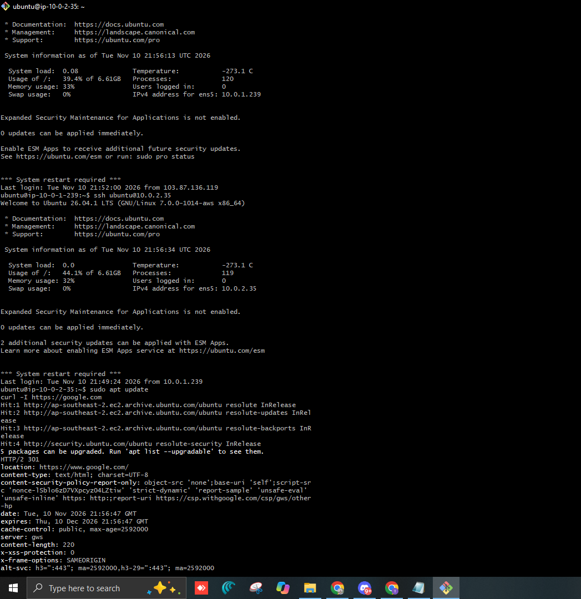

### Why the backend cannot be reached from my laptop or the internet

When I tried to SSH into `10.0.2.35` directly from my laptop, the connection timed out:

```bash
ssh -i shopbondhu-key.pem -o ConnectTimeout=10 ubuntu@10.0.2.35
# ssh: connect to host 10.0.2.35 port 22: Connection timed out
```


This is expected, for three reasons:

1. **Private IP address.** `10.0.2.35` is a private address inside the VPC. Internet traffic cannot be routed to it, and my laptop is outside the VPC.
2. **No public IP.** The backend has no Elastic IP and no auto-assigned public IP, so nothing outside the VPC can address it directly.
3. **Restrictive security group.** `shopbondhu-backend-sg` allows SSH only from `shopbondhu-web-sg`. Even a machine inside the same subnet would be refused unless it belonged to the web security group.

Outbound traffic still works because the private route table sends `0.0.0.0/0` to the NAT Gateway. The NAT Gateway lets connections start from inside the VPC, but it does not accept new connections started from the internet.

---

## Troubleshooting Answers

### Problem A: The website does not open in the browser, but SSH to the web server works

If SSH works, the instance is running, has a public IP, and its security group allows port 22. The problem is therefore specific to HTTP traffic on port 80 or to the web server software. I would check the following:

1. **Security group rule for HTTP.** `shopbondhu-web-sg` must allow inbound TCP port 80 from `0.0.0.0/0`. I would open the instance's Security tab in the EC2 console and confirm that the rule exists and is attached to the instance. SSH working does not prove that port 80 is open.
2. **Nginx service status.** Nginx may have stopped or failed to start. I would run `sudo systemctl status nginx` to confirm it shows `active (running)`. If it is stopped, I would check `sudo journalctl -u nginx` for errors and restart it with `sudo systemctl restart nginx`.
3. **Public IP address.** If the instance was stopped and started, its public IP changes, and the browser would be using an old address. I would compare the address in the browser with the public IPv4 shown in the EC2 console. An Elastic IP on the web server would prevent this.
4. **Host firewall (UFW).** The server's own firewall could block port 80 even though the security group allows it. I would run `sudo ufw status`. If UFW is active without an HTTP rule, I would allow Nginx with `sudo ufw allow 'Nginx Full'`.
5. **Route table and Internet Gateway.** The public subnet must route `0.0.0.0/0` to the Internet Gateway. Without this route, the server may accept SSH from some networks but cannot serve web traffic. I would check the Routes and Subnet associations tabs of `shopbondhu-public-rt`.

Since SSH works, the most likely causes are the security group rule for port 80 or the state of the Nginx service.

### Problem B: `sudo apt update` on the backend hangs and times out

The backend has no public IP, so all its outbound traffic must pass through the NAT Gateway. A timeout means that traffic is not reaching the internet. I would check the following:

1. **NAT Gateway location.** The NAT Gateway must be in the public subnet, not the private subnet. A NAT Gateway in the private subnet has no route to the Internet Gateway, so it cannot forward traffic. I would check the subnet shown in the NAT Gateway's details page.
2. **Elastic IP attachment.** A public NAT Gateway needs an Elastic IP to send traffic to the internet. If the Elastic IP was not allocated or attached, the NAT Gateway cannot communicate externally. I would confirm that the NAT Gateway shows a primary public IPv4 address and that its state is `Available`.
3. **Private route table.** `shopbondhu-private-rt` must contain `0.0.0.0/0` pointing to `shopbondhu-nat`, and it must be associated with `shopbondhu-private-subnet`. If the route is missing or points to the Internet Gateway, the backend has no path to the internet.
4. **Internet Gateway and public route.** The NAT Gateway reaches the internet through the Internet Gateway. If the Internet Gateway is not attached to the VPC, or `shopbondhu-public-rt` lacks a `0.0.0.0/0` route to it, the NAT Gateway cannot forward packets.
5. **Security group and network ACL.** The backend's outbound rules must allow traffic (the default allows all outbound), and the network ACL for the private subnet must allow return traffic on ephemeral ports.

The most likely causes in this setup are an incorrect route in the private route table or a NAT Gateway that is not in the public subnet.

---

## Security Notes

- The `.pem` private key is not part of this repository. The `.gitignore` file contains `*.pem`, which prevents it from being committed.
- During setup, I copied the private key to the web server by mistake. I removed it with `rm -f ~/shopbondhu-key.pem`, and `ls ~` confirmed that it was gone.
- I accessed the backend with SSH agent forwarding (`ssh -A`), so the private key was not stored on any server.
- SSH access to the web server is restricted to my public IP. My public IP changed several times during the session, and I updated the security group rule each time.

---

## Cleanup

> **Status: pending.** This section will be updated after the resources are removed.

To avoid ongoing charges, the following resources will be removed after the assignment is submitted:

- [ ] EC2 instances `shopbondhu-web` and `shopbondhu-backend` terminated
- [ ] NAT Gateway `shopbondhu-nat` deleted (screenshot: `screenshots/13-nat-deleted.png`)
- [ ] Elastic IP released (screenshot: `screenshots/14-eip-released.png`)

**Why this matters:** A NAT Gateway is billed for every hour it exists, even when it carries no traffic. An Elastic IP that is not attached to a running instance is also billed. Leaving these resources running would add charges unrelated to the actual work of the project.

---

## What I Learned

- A custom VPC gives full control over IP ranges, subnets, and routing, so the default VPC does not need to be used for this kind of setup.
- A subnet becomes public only because its route table sends `0.0.0.0/0` to an Internet Gateway. The "auto-assign public IP" setting alone does not make a subnet reachable.
- A NAT Gateway lets private resources download updates from the internet while keeping them unreachable from outside. It must be placed in a public subnet.
- Security groups can reference other security groups as a source, which restricts backend access more reliably than IP addresses.
- SSH agent forwarding lets me reach a private server through a jump host without copying the private key onto any machine in between.

---

## Repository Structure

```
shopbondhu-aws-assignment/
├── README.md
├── commands.md
├── .gitignore
├── frontend/
│   ├── index.html
│   ├── style.css
│   └── script.js
└── screenshots/
    └── (screenshots referenced above)
```
